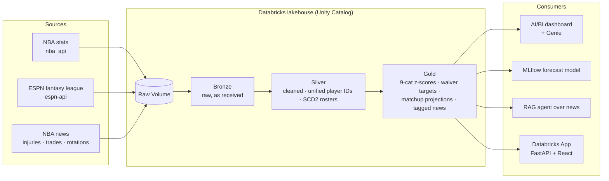

# nba-intelligence

**A Databricks Medallion Lakehouse that turns NBA stats, fantasy-league data and NBA news into decisions.**

It brings three kinds of data into one governed platform:
- player and game stats;
- data from my ESPN fantasy league;
- the news that moves both.

It then turns them into answers for a 9-category fantasy league (who to pick up, who to start, how this week's matchup is likely to go) and general data to keep me on top of what's happening across the NBA.

> **Status:** Early build. The project setup is in progress; see the [Roadmap](#roadmap).

---

## About me and why this project exists

I'm **Fuad Gafarzada**, a Senior Data Engineer. I've spent five years building data platforms for consulting clients with:
- Databricks, Spark, Airflow and BigQuery;
- medallion-architecture lakehouses.

I'm a certified **Databricks Data Engineer Professional** and **Google Cloud Professional ML Engineer**.

I've played and watched basketball for over 12 years, and have a passion for data. I'm also part of a competitive ESPN fantasy basketball league, looking to get an edge. This project is where those two passions meet, to achieve that goal.

Fantasy basketball is a challenging and interesting data problem: you have many sources, messy player identities, news that changes everything overnight, and a decision to make every day. It's also a small-scale version of what an NBA team's analytics department deals with.

My client work is confidential, so this repo is also a publicly available example of how I build: end to end, from raw ingestion in the backend to a working app for end users, with the engineering practices I'd use in production.

---

## What it does

My league scores **9 categories**: PTS, REB, AST, STL, BLK, 3PM, FG%, FT% and TO. The platform answers questions like:

- **Who should I pick up?** It ranks waiver targets by z-score value across the 9 categories, for the season and for the last 7, 14 and 30 days.
- **How will this week's matchup go?** It projects each category, taking into account how many games each team plays that week.
- **What just changed?** It covers injuries, trades, signings, rotation and minutes changes, and rest days, with each news item tagged to the right player.
- **Which guards are trending up this month?** You can ask questions like this in plain English using Genie.

---

## Architecture (TBC)



- **Bronze** keeps the raw data exactly as it arrived for replayability. Files land in a Unity Catalog Volume and Auto Loader ingests them incrementally.
- **Silver** cleans and standardises the data. The hardest problem here is matching each player to **one ID across all sources**. Rosters keep their full history (slowly changing dimensions type 2), so trades and signings are tracked over time.
- **Gold** holds the tables built for specific uses: category value scores, waiver targets, weekly projections, games-per-week, injury status and news tagged by player.
- The pipeline is a **Lakeflow Declarative Pipeline** with data-quality expectations and incremental loads.

---

## Tech stack

| Area | Tools |
|---|---|
| Platform | Databricks (serverless), Unity Catalog |
| Pipelines | Lakeflow Declarative Pipelines, Auto Loader, Delta Lake |
| AI / ML | AI Functions, MLflow, a hand-built RAG agent |
| Analytics | AI/BI dashboards, Genie |
| App | Databricks Apps (FastAPI and React/TypeScript) |
| Infrastructure as code | Databricks Asset Bundles (`dev` and `prod` targets) |
| Engineering | Python 3.12, `uv`, `ruff`, `pytest`, pre-commit, GitHub Actions |

---

## Roadmap

- [ ] Project setup: environment, Asset Bundle, CI/CD, Unity Catalog, secrets
- [ ] Spike: test whether each data source can be reached from Databricks
- [ ] Ingestion and the bronze/silver/gold model
- [ ] Lakeflow pipeline with data-quality expectations, SCD2 and incremental loads
- [ ] AI/BI dashboard and Genie space
- [ ] AI Functions on news: player and team extraction, sentiment, injury and trade tags
- [ ] MLflow player performance forecast
- [ ] RAG agent over NBA news
- [ ] Databricks App front end (FastAPI and React/TypeScript)
- [ ] Architecture diagram, cost estimate and value summary

Design decisions are recorded in [`docs/decisions/`](docs/decisions/) as they're made.

---

## Repository layout

The layout below is planned and will fill in as the build progresses.

```
src/ingestion/    # source clients and landing files in Volumes
src/pipelines/    # bronze / silver / gold (Lakeflow)
src/app/          # Databricks App (FastAPI + React/TS)
tests/
resources/        # bundle resource YAMLs (jobs, pipelines, app)
docs/             # architecture, decisions, value summary
databricks.yml
pyproject.toml
```

---

## Getting started

**Prerequisites:**
- Python 3.12 (this matches Databricks serverless);
- [`uv`](https://docs.astral.sh/uv/);
- the [Databricks CLI](https://docs.databricks.com/dev-tools/cli/).

```bash
git clone https://github.com/fuadgaf/nba-intelligence.git
cd nba-intelligence
uv sync
```

Deployment steps will be added with the Asset Bundle.

**Secrets** are never committed to this repo:
- locally, they go in a `.env` file (already in `.gitignore`);
- in Databricks, they live in a secret scope;
- in CI, they're stored as GitHub Secrets.

---

## Disclaimer

This is a personal, non-commercial project. It isn't affiliated with or endorsed by the NBA, ESPN or any team (although if the Chicago Bulls would like to use it please feel free). All data belongs to its respective owners and is accessed in line with terms of use.

## License

[MIT](LICENSE)
